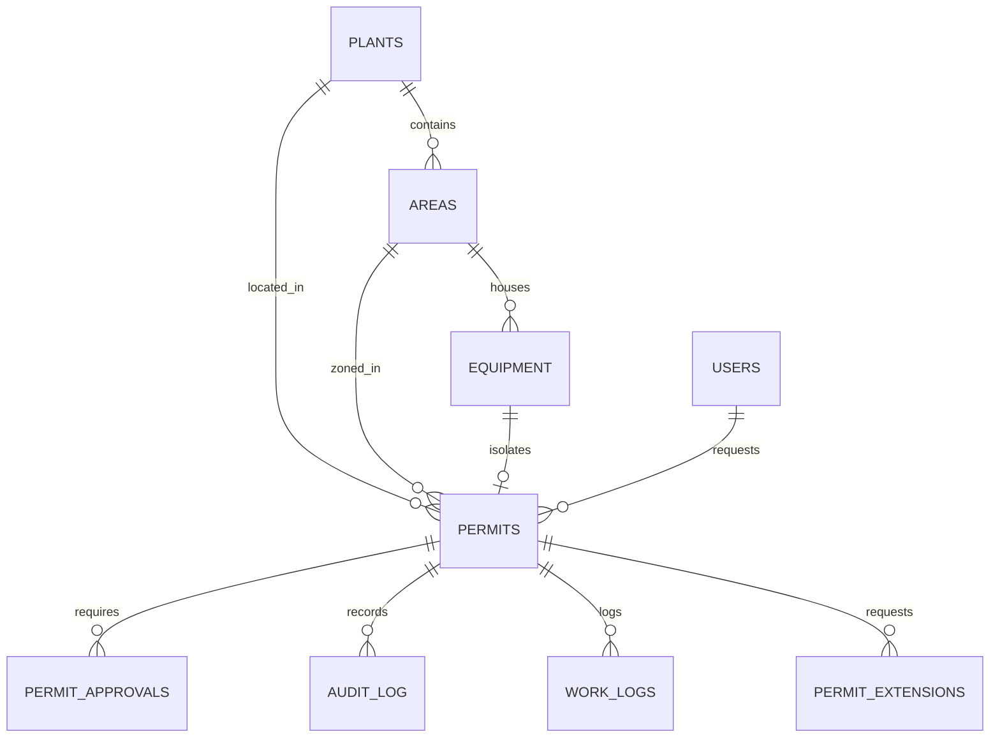
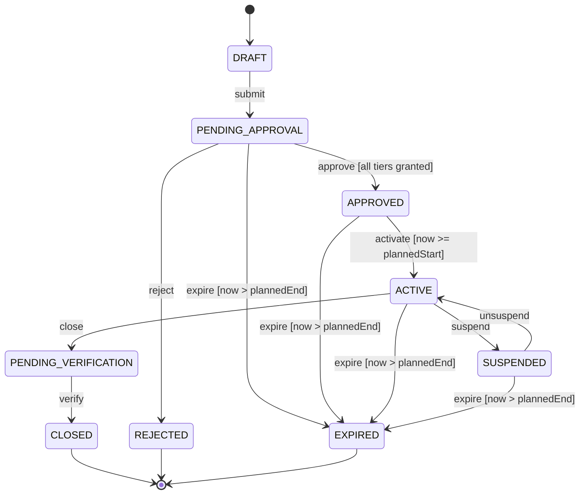

# Opmaint PTW — Industrial Permit to Work CMMS

Server-authoritative Permit to Work (PTW) safety lifecycle engine and operations portal for industrial facilities.

[](https://github.com/forex911/opmaint-ptw/actions/workflows/ci.yml)

---

## 1. Live Deployment & Demo Accounts

| Resource | URL |
| :--- | :--- |
| **Web Application** | [https://cmms-three-dun.vercel.app](https://cmms-three-dun.vercel.app) |
| **API Health Endpoint** | [https://opmaint-ptw.onrender.com/health](https://opmaint-ptw.onrender.com/health) |
| **GitHub Repository** | [https://github.com/forex911/opmaint-ptw](https://github.com/forex911/opmaint-ptw) |

> **Render Free-Tier Notice**: The backend API is hosted on Render's free tier. If the instance has spun down due to inactivity, the initial API call may take ~30–50 seconds to cold start.

### Seeded Reviewer Accounts
All demo accounts share the password: `PtwPass2026!` (Clickable quick-fill buttons are provided on the login page).

| Role | Email | Assigned Area / Responsibility | What to Try |
| :--- | :--- | :--- | :--- |
| `REQUESTER` | `requester@cmms.local` | Field Contractor / Requester | Draft a Hot Work permit, submit it, activate after approval, record work logs, submit closure. |
| `AREA_OWNER` | `area.owner@cmms.local` | Manali Petrochemical — Alkylation Unit 02 | Review pending permits in assigned area, approve or reject with mandatory safety remarks. |
| `SAFETY_OFFICER` | `safety.officer@cmms.local` | Plant Safety Superintendent | Provide second-tier approval, suspend an active permit on safety grounds, verify final closure. |
| `ADMIN` | `admin@cmms.local` | System Administrator | Inspect system-wide plant/area reference data hierarchy, test emergency overrides. |

---

## 2. 60-Second Reviewer Tour

### Happy Path (Full Lifecycle)
1. **Login as Requester**: Sign in as `requester@cmms.local`.
2. **Draft a Permit**: Click **New Permit**. Select **Hot Work**, facility **Manali Petrochemical Complex** (`PLANT-CHE-01`), area **Alkylation & Reforming Unit 02** (`AREA-MPC-01`), and equipment **Switchgear Unit 01** (`SWG-01`). Set planned start to current time, planned end to +4 hours. Enter pre-entry gas readings (e.g. O2: `20.9%`, LEL: `0%`, CO: `0 ppm`, tested within 60 min). Click **Save Draft**.
3. **Submit for Approval**: Open the created draft and click **Submit Permit**. The state transitions to `PENDING_APPROVAL`. The system snapshots the area owner and provisions two approval gates (`AREA_OWNER` and `SAFETY_OFFICER`).
4. **Area Owner Sign-Off**: Sign out, sign in as `area.owner@cmms.local`. Under **Pending Approvals**, locate the permit. Click **Approve** and provide an isolation verification comment.
5. **Safety Officer Sign-Off**: Sign out, sign in as `safety.officer@cmms.local`. Locate the permit, click **Approve**. Both approval gates are satisfied; status transitions to `APPROVED`.
6. **Activate**: Sign out, sign in as `requester@cmms.local`. Click **Activate Permit**. Status transitions to `ACTIVE`.
7. **Log Field Work**: Under **Work Logs**, record a progress log: kind `PROGRESS`, notes `Welding begun on header pipe`.
8. **Close Out**: Click **Close Permit**, enter required housekeeping and equipment isolation restoration sign-off notes. Status transitions to `PENDING_VERIFICATION`.
9. **Final Verification**: Sign in as `safety.officer@cmms.local`. Click **Verify Closure**. Status reaches terminal `CLOSED`.

### 3 "Try to Break It" Edge Cases
- **Action 1: Self-Approval Prevention**: Sign in as `safety.officer@cmms.local`. Create and submit a permit. Attempt to approve your own permit.
  - **Result**: Rejected with HTTP `403 SELF_APPROVAL_FORBIDDEN` (`guards.ts:34`). The Four-Eyes principle prevents requesters from approving their own work.
- **Action 2: Premature Activation**: Create and fully approve a permit scheduled with `plannedStart` set 24 hours into the future. Attempt to activate it immediately.
  - **Result**: Rejected with HTTP `409 EARLY_ACTIVATION` (`guards.ts:108`). Permits cannot become active before their scheduled start window.
- **Action 3: Cross-Area Approval Breach**: Sign in as `area.owner@cmms.local`. Attempt to approve a permit situated in `AREA-MPC-03` (owned by `area.owner2@cmms.local`).
  - **Result**: Rejected with HTTP `403 AREA_OWNER_MISMATCH` (`guards.ts:54`). Only the assigned area owner can sign off on their physical facility.

---

## 3. Architecture

The system is structured as an npm workspaces monorepo with server-side business rules and strict separation of concerns.

```mermaid
flowchart TD
  Client["Browser Client (React 18 + Vite SPA)"]
  Vercel["Vercel Edge (/api/* reverse proxy rewrite)"]
  API["API Service on Render (Node.js Express ESM)"]
  DB[(Neon Serverless PostgreSQL 16)]
  Cron["External Expiry Cron / Sweeper Task"]

  Client -->|Same-Origin HTTP + Cookies| Vercel
  Vercel -->|HTTPS Transparent Rewrite| API
  API -->|Drizzle ORM + pg Pool (SSL)| DB
  Cron -->|POST /internal/sweep + Bearer Secret| API
```

### Monorepo Structure
- `apps/api`: Node.js Express service, Drizzle ORM schema, migrations, state machine transition engine, and sweeper.
- `apps/web`: React 18 SPA, Vite, Tailwind CSS, React Router v6, Error Boundary.
- `packages/shared`: Shared TypeScript types, permit status and action enums, declarative permit registry, and dynamic Zod schema compiler.

### Technology Choices
- **Node.js ESM + Express**: Lightweight, battle-tested HTTP layer with native ESM module resolution.
- **PostgreSQL + Drizzle ORM**: Relational integrity with SQL-level triggers and row-level locking (`SELECT ... FOR UPDATE`).
- **Zod**: Declarative runtime schema validation shared symmetrically between backend and frontend.
- **Vercel Reverse Proxy**: Transparent `/api/*` rewrite ensures JWT session cookies remain first-party same-origin without third-party cross-site cookie restrictions.

---

## 4. Data Model



- **`permits`**: Core entity (`id`, `permit_no`, `type`, `status`, `plant_id`, `area_id`, `equipment_id`, `requester_id`, `planned_start`, `planned_end`, `version`).
- **`details` (JSONB)**: Dynamic payload storing hazard-specific checklist data (gas test readings, PPE, voltages) validated against the type registry.
- **`permit_approvals`**: Tracks required and granted approval tiers (`role`, `user_id`, `status`, `comment`, `decided_at`).
- **`audit_log`**: Append-only tamper-evident ledger (`from_state`, `to_state`, `action`, `actor_id`, `diff`, `comment`, `created_at`).
- **`work_logs`**: Chronological work and progress notes logged exclusively while in `ACTIVE` status.
- **`permit_extensions`**: Schema for duration extensions and safety justification.

### Adding a 5th Permit Type (`EXCAVATION`)
Because type-specific attributes reside in `details` (JSONB) governed by the declarative registry, adding a new permit type requires **zero database migrations and zero route modifications**. A single registry definition in `packages/shared/src/registry/definitions.ts` compiles the dynamic Zod validator automatically:

```typescript
// packages/shared/src/registry/definitions.ts
export const EXCAVATION_PERMIT_DEF: PermitTypeDefinition = {
  type: 'EXCAVATION',
  name: 'Excavation & Trenching Permit',
  fields: [
    { name: 'trenchDepthMeters', label: 'Trench Depth (m)', type: 'number', requiredOnSubmit: true },
    { name: 'undergroundUtilitiesChecked', label: 'Utility Clearance Verified', type: 'boolean', requiredOnSubmit: true },
    { name: 'shoringRequired', label: 'Trench Shoring Installed', type: 'boolean', requiredOnSubmit: true },
  ],
};
```
*Verified in `packages/shared/src/registry/schema-generator.test.ts`.*

---

## 5. State Machine & Lifecycle Engine

Permit transitions are mediated by a centralized transition engine (`apps/api/src/modules/permits/state-machine/transition-engine.ts`) executing inside database transactions with row-level locks.



### Transition Table

| From State | Action | Permitted Roles | Domain Guards & Invariants | To State |
| :--- | :--- | :--- | :--- | :--- |
| `DRAFT` | `submit` | `REQUESTER`, `ADMIN` | Complete fields, end > start, gas test <= 60m (CS), equipment assigned (D-025) | `PENDING_APPROVAL` |
| `PENDING_APPROVAL` | `approve` | `AREA_OWNER`, `SAFETY_OFFICER`, `ADMIN` | Four-Eyes check (no self-approval), assigned area owner match | `APPROVED` (if final) / `PENDING_APPROVAL` |
| `PENDING_APPROVAL` | `reject` | `AREA_OWNER`, `SAFETY_OFFICER`, `ADMIN` | Mandatory rejection comment | `REJECTED` |
| `APPROVED` | `activate` | `REQUESTER`, `ADMIN` | `now >= plannedStart`, gas test freshness re-verified <= 60m (D-010) | `ACTIVE` |
| `ACTIVE` | `suspend` | `SAFETY_OFFICER`, `ADMIN` | Mandatory suspension justification comment | `SUSPENDED` |
| `SUSPENDED` | `unsuspend`| `SAFETY_OFFICER`, `ADMIN` | Mandatory unsuspension sign-off comment | `ACTIVE` |
| `ACTIVE` | `close` | `REQUESTER`, `ADMIN` | Mandatory completion notes and housekeeping verification | `PENDING_VERIFICATION` |
| `PENDING_VERIFICATION` | `verify` | `SAFETY_OFFICER`, `ADMIN` | Safety confirmation of safe site restoration | `CLOSED` |
| Any Active State | `expire` | Automated System | `now > plannedEnd` (Evaluated on reads, writes, and cron) | `EXPIRED` |

### Core Safety Invariants
1. **Concurrency Serialization**: Handled via `SELECT ... FOR UPDATE` row locks (`transition-engine.ts:46`). Concurrent actions are serialized; the second transaction reads the committed status and fails with HTTP 409 if invalid (*Test: `concurrency.test.ts`*).
2. **Dual-Tier Expiry Engine**: Overdue permits are lazily expired on read/write queries and proactively swept every minute via `node-cron` or `POST /internal/sweep` with `x-sweep-secret` (*Test: `sweeper.test.ts`*).
3. **Injectable Clock**: All state machine functions accept an optional `now: Date` parameter for deterministic time-travel testing (*Test: `transition.test.ts`*).

---

## 6. Roles, Permissions & HTTP Error Semantics

| Action / Resource | Requester | Area Owner | Safety Officer | System Admin |
| :--- | :---: | :---: | :---: | :---: |
| **Create / Edit Draft** | Yes | No | No | Yes |
| **Submit Permit** | Yes | No | No | Yes |
| **Area Owner Approval** | No | Assigned Area Only | No | Yes (Non-author) |
| **Safety Approval** | No | No | Yes (Non-author) | Yes (Non-author) |
| **Activate Permit** | Yes | No | No | Yes |
| **Log Field Work** | Yes | No | Yes | Yes |
| **Suspend / Unsuspend** | No | No | Yes | Yes |
| **Submit Closure** | Yes | No | No | Yes |
| **Verify Closure** | No | No | Yes | Yes |
| **View Permits & Stats** | Yes | Yes | Yes | Yes |

- **Separation of Duties (D-019)**: Enforces the industrial Four-Eyes principle. Even an `ADMIN` cannot approve a permit where `requester_id === user.id`.
- **Area Owner Snapshot (D-014)**: When a permit is submitted, the current assigned owner of the area is snapshotted into `permit_approvals`. Subsequent facility owner reassignments do not orphan in-flight safety approvals.

### HTTP Error Codes
- **`401 UNAUTHORIZED`**: Missing or invalid session cookie.
- **`403 FORBIDDEN`**: Authenticated, but role or separation-of-duties barrier failed (`SELF_APPROVAL_FORBIDDEN`, `AREA_OWNER_MISMATCH`).
- **`404 NOT_FOUND`**: Target entity does not exist.
- **`409 CONFLICT`**: State machine transition barrier violation (`ILLEGAL_TRANSITION`, `EARLY_ACTIVATION`, `ALREADY_APPROVED`).
- **`422 VALIDATION_ERROR`**: Schema validation failed, missing required comment (`MISSING_COMMENT`), or location mismatch.

---

## 7. Tamper-Evident Audit Trail

Every state change, field edit, approval, and automated expiry writes an immutable record to `audit_log`.

### Database Immutability Enforcement
1. **Row Trigger (`trg_audit_log_immutable`)**: Rejects any SQL `UPDATE` or `DELETE` with `audit_log is append-only` (`0000_initial_schema.sql`).
2. **Table Trigger (`trg_audit_log_truncate`)**: Rejects SQL `TRUNCATE` operations on `audit_log`.
3. **Database Privilege Revocation**: The application role `ptw_app_user` has `UPDATE, DELETE, TRUNCATE` revoked on `audit_log`.

### Honest Threat Model
Application services and API users cannot delete or modify audit records under any circumstances (*Test: `schema.test.ts`*). However, a database superuser (`postgres` or cloud DBA) possesses root authority to disable triggers. For full non-repudiation in regulated facilities, the database should stream audit events to external write-once storage (e.g., AWS S3 with Object Lock or cloud audit sinks).

---

## 8. Domain Decisions

- **60-Minute Gas Test Freshness (`D-004`)**: Flammable gases, hydrogen sulfide, and oxygen depletion change rapidly in enclosed process vessels. Atmospheric readings taken hours prior are medically invalid at work start.
- **Atmospheric Re-Verification at Activation (`D-010`)**: Confined space permits are frequently approved days in advance. At the exact moment work begins, gas readings must be verified within the past 60 minutes.
- **Work Logs Exclusively in `ACTIVE`**: Maintenance logs represent live on-site actions. Work cannot be logged on drafts, closed permits, or suspended jobs.
- **Terminal Expiry**: If a scheduled window expires, facility conditions change (shift handovers, overlapping jobs). An expired permit cannot be extended or re-opened; a fresh permit must be drafted.
- *Refer to [docs/DECISIONS.md](docs/DECISIONS.md) for ADRs D-001 through D-027.*

---

## 9. Assumptions & Specification Gaps

- **Read Visibility (`D-020`)**: All authenticated facility users can view all permits and reference data to maintain facility-wide situational awareness.
- **In-Flight Draft Modifications (`D-021`)**: Editing a permit while in `PENDING_APPROVAL` automatically invalidates and resets existing approvals back to `PENDING`.
- **Equipment Assignment (`D-025`)**: Equipment is optional in `DRAFT` (for general plant areas), but strictly required upon `SUBMIT`.

---

## 10. Local Setup & Verification

### Prerequisites
- Node.js `v20.14+` or `v24+`
- npm `v10+`
- PostgreSQL 16+ running locally (or via Docker on port `5432` / `5433`)

```bash
# 1. Clone repository
git clone https://github.com/forex911/opmaint-ptw.git
cd opmaint-ptw

# 2. Install dependencies
npm ci

# 3. Configure environment
cp .env.example .env

# 4. Run migrations
npm run db:migrate

# 5. Seed idempotent database
npm run db:seed

# 6. Typecheck and run all tests
npm run typecheck
npm test

# 7. Start local development servers
npm run dev
```

*Windows Note: If Git hooks encounter MSYS `sh.exe` named object permission errors (`NtCreateDirectoryObject: 0xC0000022`), commits can be created with `--no-verify`; all quality gates are independently validated by GitHub Actions CI.*

---

## 11. Production Deployment

- **Database**: Neon Serverless PostgreSQL with SSL connection pooling. Migrations are executed prior to deployment via `npm run db:migrate`.
- **Backend API**: Hosted on Render. Environment variables: `NODE_ENV=production`, `DATABASE_URL`, `JWT_SECRET`, `SWEEP_SECRET`, `CORS_ORIGIN`, `COOKIE_SECURE=true`, `COOKIE_SAME_SITE=lax`.
- **Frontend SPA**: Hosted on Vercel. `vercel.json` proxies `/api/:path*`, `/health`, and `/internal/:path*` transparently to Render, preserving same-origin cookie security.
- **Background Sweeper**: Triggered by an external cron calling `POST https://opmaint-ptw.onrender.com/internal/sweep` every minute with header `x-sweep-secret`.

---

## 12. Automated Test Suite

Current test counts verified directly against the codebase:

```text
Test Files  20 passed (20)
Tests       267 passed (267)
Typecheck   0 errors across @ptw/shared, @ptw/api, @ptw/web
```

- `@ptw/shared` (6 tests): Dynamic Zod schema compiler, type registry, excavation registration.
- `@ptw/api` (228 tests):
  - `transition.test.ts` (104 tests): Table-driven state machine matrix, pure guards, lazy expiry.
  - `integration-workflows.test.ts` (28 tests): Full multi-role user journeys, rejections, separation of duties.
  - `permits.test.ts` (21 tests): CRUD, filtering, pagination, location consistency.
  - `spec-compliance.test.ts` (9 tests): Explicit specification compliance test suite.
  - `sweeper.test.ts` (15 tests): Distributed row locking, background cron, webhook sweeping.
  - `concurrency.test.ts` (4 tests): `SELECT ... FOR UPDATE` serialization.
  - `auth.test.ts` (19 tests): Login rate limiting, cookie authentication, role middleware.
  - `schema.test.ts` (11 tests): Migration execution, trigger immutability, seed idempotency.
  - `equipment-cascade.test.ts` (6 tests): Location hierarchy cascading.
  - `permits.contract.test.ts` (2 tests): API response DTO contract conformance.
  - `env.test.ts` (8 tests): Environment variable validation.
  - `permits.pagination.test.ts` (1 test): Pagination metadata.
- `@ptw/web` (33 tests): API client, error boundary, status badges, dynamic checklists, equipment cascading, pagination controls.

---

## 13. Scope Status & Future Enhancements

| Capability | Status | Implementation Notes |
| :--- | :--- | :--- |
| **Core State Machine & Guards** | Complete | Transactional `transition()` with row-level locks and 10 domain guards. |
| **Authentication & RBAC** | Complete | HTTP-only cookie sessions, Four-Eyes separation of duties, role middleware. |
| **Dynamic Form Registry** | Complete | JSONB storage for 4 hazard types with runtime Zod compilation. |
| **Audit Log Immutability** | Complete | Enforced via PostgreSQL row and statement triggers. |
| **Lazy Expiry & Sweeper** | Complete | Lazy check on query + background cron + `/internal/sweep` webhook. |
| **Equipment Hierarchy Cascade** | Complete | Responsive dropdowns with parent-child location validation. |
| **Extension Flow** | Schema Only | `permit_extensions` table migrated; HTTP endpoint deferred. |
| **SIMOPS Conflict Detection** | Deferred | Overlapping queries researched; automated collision detection engine deferred. |
| **Signature Capture UI** | Simplified | Timestamped checkbox sign-off; canvas stylus signing deferred. |
| **QR Code Verification** | Deferred | Printable physical permit card deferred. |

### If I Had More Time
1. **Simultaneous Operations (SIMOPS) Conflict Engine**: Automatically flag hazardous co-located permits (e.g. Hot Work directly adjacent to Confined Space fuel venting).
2. **Interactive Extension Workflow**: Allow field teams to request 2-hour extensions subject to area owner re-isolation sign-off.
3. **Live SSE/WebSocket Updates**: Real-time push notifications when an approval or suspension is triggered.
4. **Per-Plant RBAC Scoping**: Partition users and permissions strictly by plant facility.
5. **Playwright Browser E2E Suite**: End-to-end browser integration testing across the live Vercel and Render infrastructure.

---

## 14. AI Usage Disclosure

- **Tools Used**: Claude 3.5 Sonnet / Gemini for architecture planning, boilerplate implementation, and test generation; Antigravity agentic workflows for file creation and test execution.
- **Division of Labor**: I directed architecture, defined the domain state machine, drafted database schemas, wrote specification guard rules, and manually reviewed all pull requests and diffs. The AI generated initial boilerplate code, unit test fixtures, and repetitive React UI controls.
- **Bugs Caught by Reviewer**:
  - *React Child Rendering Failure*: AI attempted to render JSONB audit entries directly as React children; fixed with structured formatting.
  - *Cascading Seed Deletion*: AI initially used `DELETE FROM permits`, triggering foreign key updates blocked by the immutable audit trigger; corrected to non-destructive upserts.
  - *Empty String Equipment Validation*: Fixed frontend payloads sending `""` instead of `null` or omitted keys.
  - *Supertest Agent State Loss*: Replaced unauthenticated HTTP requests in compliance tests with persistent supertest agent sessions.
- *Refer to [docs/AI_USAGE.md](docs/AI_USAGE.md) for the exhaustive log.*

---

## 15. Known Issues

1. **Render Free-Tier Cold Starts**: On initial access after inactivity, Render services spin down, requiring 30–50s for first response.
2. **Windows Git Hook Named Object Permissions**: Cygwin/MSYS `sh.exe` subshells intermittently fail with `NtCreateDirectoryObject: 0xC0000022` inside Windows sandbox processes; pre-commit checks are backed by GitHub Actions CI.
3. **Stateless JWT Revocation**: Calling logout clears the client cookie, but the JWT remains cryptographically valid until its 8-hour expiry window ends. Mitigated by querying user active status on each request.
- *Refer to [docs/KNOWN_ISSUES.md](docs/KNOWN_ISSUES.md) for details.*

---

## 16. Repository Map

```text
├── apps/
│   ├── api/                      # Node.js Express backend service
│   │   ├── src/
│   │   │   ├── db/               # Drizzle schemas, migrations, seed script
│   │   │   ├── middleware/       # Auth, role guard, rate limiting, error handling
│   │   │   └── modules/          # Auth, permits, reference, and internal routes
│   │   └── vitest.config.ts      # API test configuration
│   └── web/                      # React 18 + Vite frontend SPA
│       ├── src/
│       │   ├── components/       # UI elements, dynamic checklists, error boundaries
│       │   ├── context/          # Auth and permit session state
│       │   └── pages/            # Login, Overview, Permits List, Create, Details
│       └── vercel.json           # Reverse-proxy rewrite rules to Render API
├── packages/
│   └── shared/                   # Shared types, Zod schemas, permit registry
├── docs/                         # Engineering documentation & ADRs
│   ├── ARCHITECTURE.md           # System components & data flows
│   ├── API.md                    # Endpoint contracts & error payloads
│   ├── DECISIONS.md              # Architecture Decision Records (D-001 - D-027)
│   ├── PROGRESS.md               # Chronological engineering task log
│   ├── AI_USAGE.md               # AI transparency log & human corrections
│   └── KNOWN_ISSUES.md           # Technical debt & deferred features
├── CHANGELOG.md                  # Release version history
└── README.md                     # This document
```
