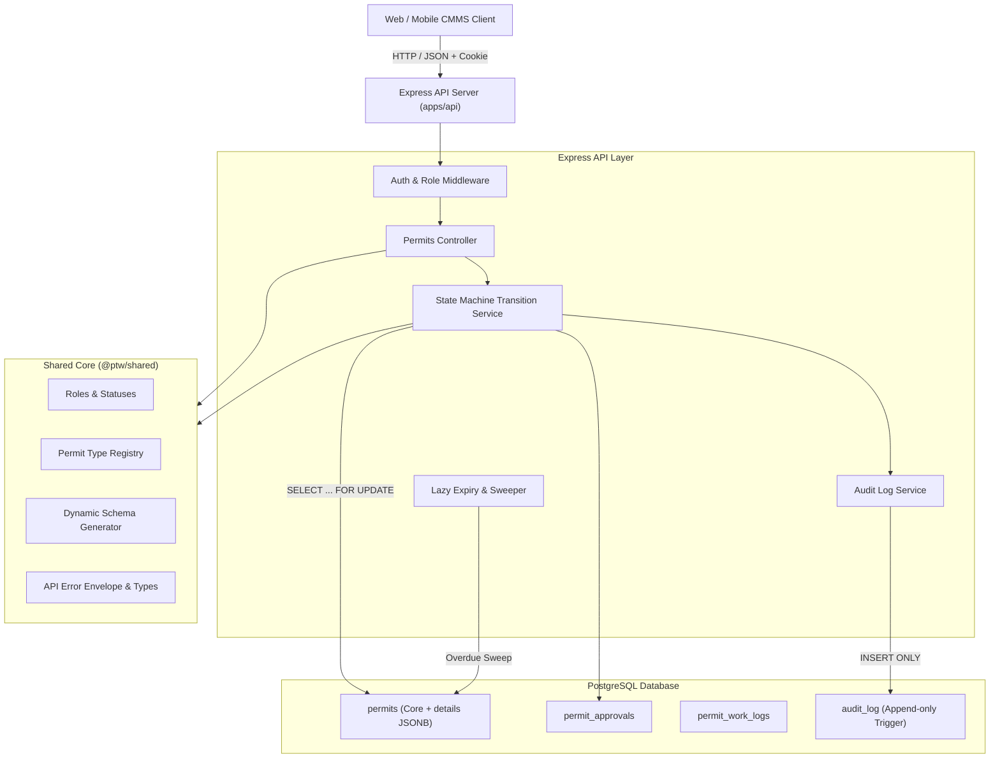
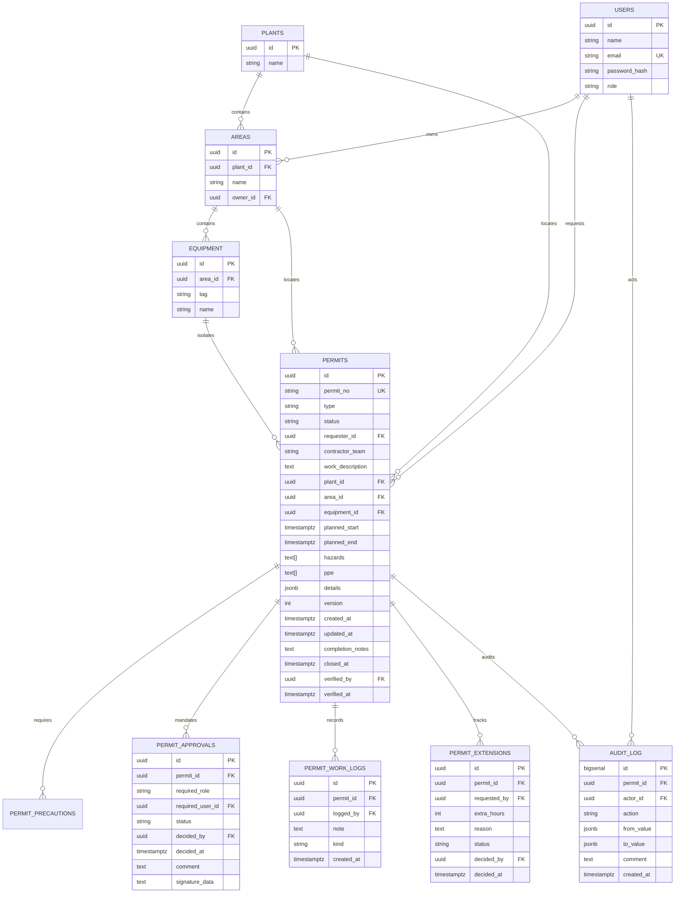
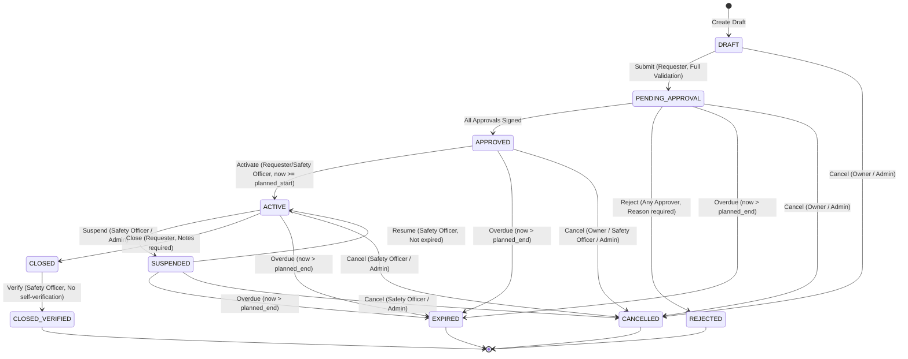
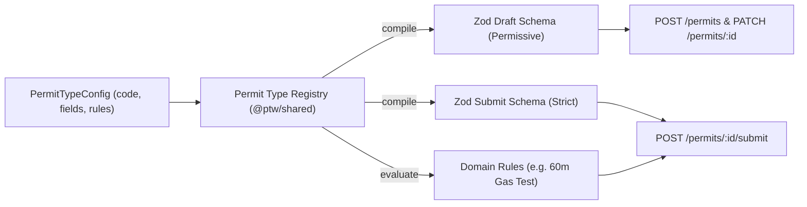

# System Architecture - CMMS Permit to Work (PTW)

## 1. High-Level System Architecture

The Permit to Work (PTW) module is a backend service for industrial plant maintenance safety management. It governs the authorization lifecycle of dangerous maintenance operations (hot work, confined space, working at height, electrical LOTO).



---

## 2. Entity Relationship Diagram (ERD)



---

## 3. Permit Lifecycle State Machine

All transitions are strictly managed in the backend state machine. Direct writes to permit status are prohibited.



---

## 4. Permit Type Extensibility Architecture



---

## 5. Background Expiry Sweeper & Distributed Transaction Flow

```mermaid
sequenceDiagram
    autonumber
    participant Sweeper as ExpirySweeper / POST /internal/sweep
    participant DB as PostgreSQL 16 (ptw_cmms)
    participant StateMachine as transition() Engine
    participant Audit as audit_log (Append-Only)

    Note over Sweeper,DB: 1. Begin Batch Transaction & Row-Level Locking
    Sweeper->>DB: BEGIN;
    Sweeper->>DB: SELECT id FROM permits WHERE status IN ('PENDING_APPROVAL','APPROVED','ACTIVE','SUSPENDED') AND planned_end <= NOW() ORDER BY planned_end ASC FOR UPDATE SKIP LOCKED;
    DB-->>Sweeper: candidateIds = [id1, id2, ...] (Row locks held on connection)

    Note over Sweeper,Audit: 2. Per-Permit Savepoints & Authoritative Transitions
    loop For each candidate permit ID
        Sweeper->>StateMachine: transition(id, 'expire', actor=SYSTEM, client, now)
        StateMachine->>DB: SAVEPOINT sp_id;
        StateMachine->>DB: SELECT * FROM permits WHERE id = id FOR UPDATE;
        StateMachine->>DB: UPDATE permits SET status = 'EXPIRED', version = version + 1 WHERE id = id;
        StateMachine->>Audit: INSERT INTO audit_log (actor_id = NULL, action = 'expire', ...);
        alt Transition & Audit Success
            StateMachine->>DB: RELEASE SAVEPOINT sp_id;
        else Transition Failure / Constraint Error
            StateMachine->>DB: ROLLBACK TO SAVEPOINT sp_id;
        end
    end

    Note over Sweeper,DB: 3. Atomic Commit & Release of Distributed Row Locks
    Sweeper->>DB: COMMIT;
    Note over DB: All transitions and audit entries committed simultaneously; candidate row locks released.
```

